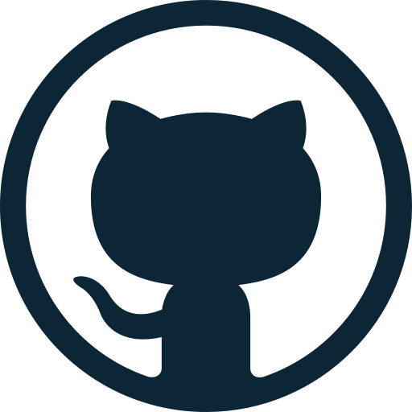
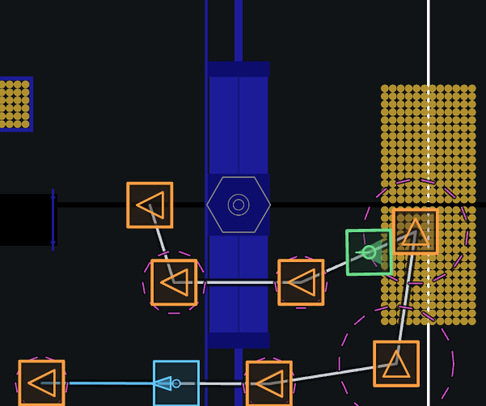
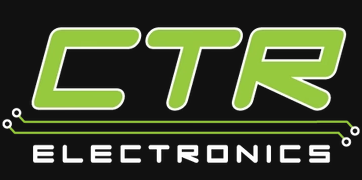

# Installation

There's a couple of resources needed to test/run/create code for The Flying Toasters. Here's a list of all the software we use.

1. [WPILib Environment](#wpilib-environment) (IDE & Robot Libraries)
1. [Github Desktop](#github-desktop) (Distribution Control System)
1. [B-Line](#b-line) (Path Generation)
1. [Phoenix Tuner X](#phoenix-tuner-x) (Configure CTRE Devices)
1. [AdvantageScope](#advantagescope) (Code Visualizer)
1. [FRC Game Tools](#frc-game-tools) (Drive Station)

## WPILib Environment 

WPILib is a framework that makes FRC programming simple and streamline for all teams. Installation instructions can be found on [WPILib's website](https://docs.wpilib.org/en/stable/docs/zero-to-robot/step-2/wpilib-setup.html).

Supports:

- Windows
- macOS
- Linux

## Github Desktop 

Github Desktop is an application that provides a nice visual interface for git. Git is a distribution version control system, which is like a fancy word for google docs for programming (with a lot of cool features). Github Desktop is not necessarily needed, but it makes using git way easier. Installation Instructions are found on found on [Github Desktop's website](https://desktop.github.com/download/).

Supports:

- Windows
- macOS

If you are using Linux, you can opt to use git in terminal or install the community made [shiftkey version](https://github.com/shiftkey/desktop/releases).

## B-Line



B-Line is an autonomoous path generation software for FRC. The Flying Toasters prefers to use B-Line over other path-generation (Pathplanner, Choreo) since it uses Geometric/state-based following over time-parameterized trajectory. More information can be found on [B-Line's documentation](https://bline-docs.pages.dev/concepts/design-philosophy/#a-polyline-not-a-spline), but in short, we found better results with B-Line, especially with path-correcting in comparison to Pathplanner/Choreo.

We use B-Line GUI in pair with Java command structure. Installation for B-Line GUI can be found on [their documentation site](https://bline-docs.pages.dev/getting-started/installation/).

Supports:

- Windows
- macOS
- Linux

## Phoenix Tuner X 

Phoenix Tuner X is a tool that lets you configure CTRE Devices. It is necessary to update, diagnose issues, and put canIDs on CTRE Devices. This is installed on the programming laptops so this isn't a requirement. Installation can be found on [CTRE's website](https://v6.docs.ctr-electronics.com/en/stable/docs/tuner/index.html).

Supports:

- Windows
- macOS
- Android/iOS

If you are using Linux, there is no alternative, so just use the programming laptops if you need for some reason.

## AdvantageScope 

AdvantageScope is a visualizer that let's us diagnose issues, simulate robot code, and log values easily. This program can be heavy when running with other applications. Installation can be found on [their github release page](https://github.com/Mechanical-Advantage/AdvantageScope/releases/tag/v26.0.2)

Supports:

- Windows
- macOS
- Linux

For Windows: download and extract the folder labeled

```text
advantagescope-wpilib-win-x64.zip
```

## FRC Game Tools

FRC Game tools is a software bundle that includes the driver station and roboRIO imaging tool. If you aren't planning on running the actual code on your computer, then just use the programming laptop/driver station laptop to run the code. You must create a NI account to download the game tools. Download can be found on [NI's website](https://www.ni.com/en/support/downloads/drivers/download.frc-game-tools.html#581857). 

Supports

- Windows
- That's it

This is not needed for most programmers, so not a requirement.